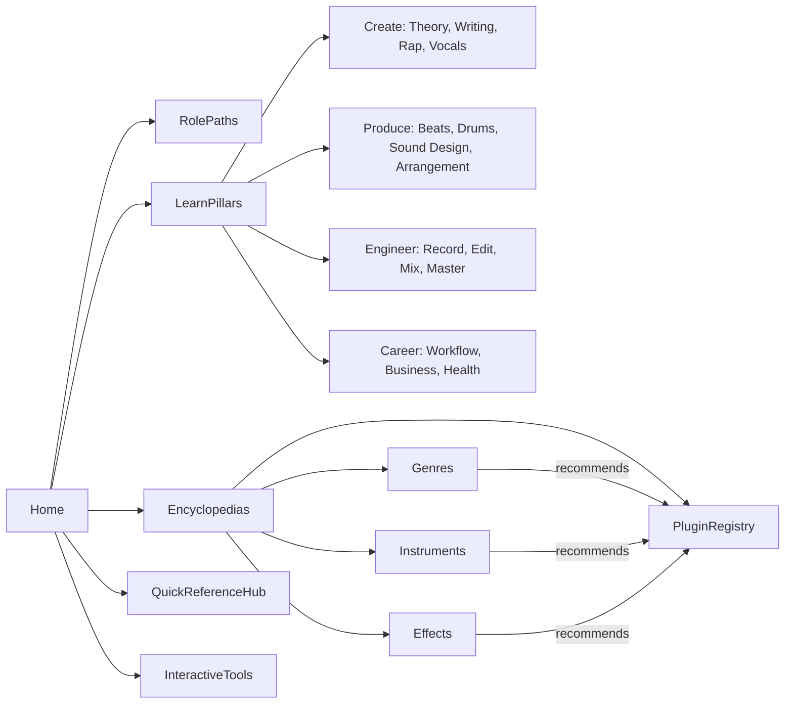

# MusiKit Master Outline

The canonical table of contents for MusiKit. Every page, entry, and tool in the app maps to a Part and section here. Change this file first when the scope changes.

## Navigation Map

## Master Outline

### Part 0: Start Here
- **0.1 How to use MusiKit:** Guide versus Cheat Sheet mode, color and callout legend, skill and role tags, search, bookmarks.
- **0.2 Role-based learning paths (ordered module lists):** Complete Beginner, Beatmaker, Songwriter/Topliner, Singer, Rapper/MC, Recording Engineer, Mix Engineer, Mastering Engineer, Artist-Entrepreneur, Media Composer.
- **0.3 The full pipeline:** idea, writing, pre-production, production, recording, editing, mixing, mastering, release, promotion, performance.
- **0.4 Roles and credits:** artist, producer, co-producer, executive producer, beatmaker, topliner, songwriter, composer, arranger, session musician, recording and assistant engineer, vocal producer, mix engineer, mastering engineer, A&R, manager. Also covers how the word "producer" means different things in hip-hop, rock, and EDM.
- **0.5 Bedroom-studio priorities:** song first, then performance, arrangement, recording, mix, master; the 80/20 of quality.
- **0.6 Myth-Buster index:** links to every myth callout in the guide.

### Part 1: Foundations (Studio, Gear and Audio Science)
- **1.1 Studio builds by budget:** $0 (phone or laptop plus free tools), around $300, $1,000, $3,000, and a pro project studio; the order in which to upgrade.
- **1.2 Computers:**
  - CPU, RAM, and SSD requirements; Mac versus Windows versus Linux.
  - Audio drivers (ASIO, Core Audio, WASAPI).
  - OS tuning; dedicated drives for sample libraries.
- **1.3 DAWs:**
  - Profiles and best fits: Ableton Live, FL Studio, Logic Pro, Pro Tools, Cubase, Studio One, Reaper, Bitwig, Reason, Cakewalk/Sonar, GarageBand, BandLab, Luna, Digital Performer, Ardour, LMMS, Renoise, Waveform; MPC and Maschine software.
  - Strong stock plugins in each.
  - Which genres tend to use which DAW.
  - Quick-start cards for each DAW.
- **1.4 Audio interfaces:**
  - Inputs and outputs; preamps; phantom power; Hi-Z instrument inputs.
  - Round-trip latency; clocking; loopback.
- **1.5 Monitors and headphones:**
  - Nearfield monitor sizes; ported versus sealed; subwoofers.
  - Open versus closed headphones; in-ear monitors (IEMs).
  - Headphone correction; multiple systems to check translation.
- **1.6 MIDI and hardware:**
  - Keyboards (key count, weighted keys), pad controllers, MPE controllers, control surfaces.
  - DAWless setups; MIDI 1.0 and 2.0; clock sync; CV/gate.
- **1.7 Cables and accessories:**
  - XLR, TRS, TS; balanced versus unbalanced.
  - ADAT and S/PDIF; USB-C.
  - Stands, pop filters, reflection filters; ground loops and power conditioning.
- **1.8 Mobile production:** GarageBand iOS, Logic for iPad, Koala Sampler, BandLab, FL Studio Mobile; portable recorders.
- **1.9 Audio science:**
  - The physics of sound: waves, frequency and pitch, amplitude, wavelength, phase versus polarity, harmonics and overtones, timbre, envelopes.
  - The colored frequency-spectrum chart.
  - Decibel types: dBFS, dBu, dBV, dB SPL, dBTP, LUFS.
  - The inverse-square law; comb filtering.
  - Psychoacoustics: equal-loudness curves, masking, the Haas (precedence) effect, the missing fundamental, critical bands.
- **1.10 Digital audio:**
  - Sample rate and bit depth; Nyquist and aliasing; oversampling; dither; 32-bit float.
  - Buffer size and latency; plugin delay compensation.
  - File formats (WAV, AIFF, FLAC, ALAC, MP3, AAC, OGG, Opus); lossy versus lossless.
- **1.11 Signal flow and gain staging:**
  - Inserts versus sends; pre- and post-fader; buses, aux tracks, VCAs, sidechains.
  - The -18 dBFS reference; headroom; analog versus digital clipping.
  - Meter types: peak, RMS, VU, LUFS, true peak.
- **1.12 Acoustics and room treatment:**
  - Room problems: room modes, standing waves, flutter echo.
  - Treatment: the first-reflection mirror trick, bass traps, broadband absorbers, diffusers, ceiling clouds.
  - Setup: the 38% listening position, equilateral-triangle speaker placement, tweeter height, desk reflections, decoupling.
  - Special cases: DIY panels; treating a closet or vocal booth; soundproofing versus treatment.
  - Measuring with REW (Room EQ Wizard, a free room-measurement app); room correction (SoundID Reference, ARC, monitors with built-in DSP).
- **1.13 Monitoring practice:**
  - Calibrated listening levels; mono checks; checks on small speakers, in the car, and on earbuds; managing ear fatigue.

### Part 2: Music Theory
- **2.1 Pitch:** notes, octaves, the piano layout, enharmonics, staff basics, reading a piano roll, MIDI note numbers, tuning references (with a myth-buster on 432 Hz).
- **2.2 Rhythm and meter:**
  - Note values, rests, dots and ties, tuplets.
  - Simple, compound, and odd meters (5/4, 7/8, 6/8, 12/8).
  - Subdivisions; syncopation; swing percentages; half-time and double-time.
  - Polyrhythm, polymeter, hemiola, metric modulation; microtiming and pocket.
- **2.3 Intervals:** qualities, consonance, emotional character, inversions, compound intervals.
- **2.4 Scales (each with formula, mood, and the genres that use it):**
  - **Core scales:** major; natural, harmonic, and melodic minor; major and minor pentatonic; blues and major blues.
  - **Modes:** the seven modes ranked by brightness; modes of harmonic minor (including Phrygian dominant); modes of melodic minor (Lydian dominant, altered).
  - **Symmetric and jazz scales:** whole tone; diminished (half-whole and whole-half); chromatic; bebop.
  - **World and exotic scales:** Hungarian minor, double harmonic, Neapolitan, Persian, Enigmatic, Prometheus; Hirajoshi, In-sen, Iwato, Yo; Pelog and Slendro; Freygish; Andalusian/flamenco Phrygian.
  - **Overviews:** Arabic maqamat (Hijaz, Rast, Bayati, Saba, Kurd, Nahawand); Indian raga and thaat basics.
- **2.5 Keys:**
  - Key signatures; an interactive circle of fifths.
  - Relative versus parallel keys; choosing a key for a vocal range.
  - The Camelot wheel (DJ key notation).
- **2.6 Chords:**
  - **Triads and sevenths:** major, minor, diminished, augmented, sus2, sus4; maj7, 7, m7, m7b5, dim7, mMaj7.
  - **Colored chords:** extensions (9, 11, 13); add, 6, and 6/9 chords; altered dominants.
  - **Other types:** power chords; slash chords and polychords; quartal and quintal chords; clusters.
  - **Voicings:** inversions; close, open, drop-2, and drop-3 voicings; shell and rootless voicings; neo-soul and gospel voicings; upper-structure triads.
- **2.7 Harmony:**
  - **Function:** diatonic chord tables; Roman numerals; tonic, predominant, and dominant function; cadences; harmonic rhythm.
  - **Progression library:** I–V–vi–IV, vi–IV–I–V, ii–V–I, I–vi–IV–V, i–VI–III–VII, the Andalusian cadence, 12-bar blues, the Royal Road progression, the "Just the Two of Us" progression, the Mario cadence (bVI–bVII–I), the Pachelbel progression, two-chord vamps.
  - **Advanced devices:** secondary dominants; borrowed chords and modal interchange; Neapolitan and augmented sixth chords; tritone substitution; chromatic mediants; passing diminished chords; pedal points; line clichés; negative harmony; reharmonization; gospel turnarounds.
  - **Modulation types:** pivot-chord, direct ("truck driver"), common-tone, chromatic.
- **2.8 Melody:**
  - Contour, range and tessitura, steps versus leaps.
  - Motif development (sequence, inversion, augmentation, fragmentation).
  - Non-chord tones (passing, neighbor, suspension, appoggiatura, anticipation).
  - Phrase length; call and response; writing countermelodies.
- **2.9 Voice leading and counterpoint:** common tones; contrary, parallel, and oblique motion; parallel fifths (and when to ignore the rule); writing bass lines; inner voices.
- **2.10 Rhythm patterns for producers:** backbeat, four-on-the-floor, son and rumba clave (3-2 and 2-3), tresillo, cinquillo, habanera, dembow, bossa and samba, Afrobeats and amapiano grooves, groove templates.
- **2.11 Tuning systems:** equal temperament, just intonation, Pythagorean tuning, maqam quarter-tones, the 22 shrutis, gamelan tunings, microtuning in synths (MTS-ESP, Scala files).
- **2.12 Emotion map:** happy, sad, dark, epic, dreamy, tense, nostalgic, sensual, and triumphant moods, each mapped to modes, progressions, tempos, and instruments.
- **2.13 Theory shortcuts:** scale lock; chord-trigger plugins (Scaler, Captain Chords, Cthulhu, Chordjam); when these help and when they hold you back.
- **2.14 Cheat sheets:** circle of fifths; chord formulas; scale formulas; the mode brightness ladder; progressions by mood; interval-to-semitone chart.

### Part 3: Ear Training and Critical Listening
- **3.1 Musical ear training:**
  - Pitch matching; intervals; chord qualities; progressions; scale degrees.
  - Melodic and rhythmic dictation; transcription.
  - Solfège; relative versus perfect pitch.
- **3.2 Technical ear training:**
  - Frequency recognition (octave bands, then third-octave bands); hearing EQ boosts and cuts; 1 dB level differences.
  - Hearing compression artifacts; hearing distortion.
  - Recognizing reverb size and pre-delay; recognizing delay times.
  - Judging width and panning; spotting phase problems.
  - Hearing noise, clicks, aliasing, and codec artifacts.
- **3.3 Reference analysis:**
  - A song-deconstruction template: structure, instrumentation, frequency map, stereo and depth map, dynamics, vocal production, ear candy.
  - Building a genre reference library.
- **3.4 Tools:** SoundGym, TrainYourEars, Quiztones, Mix Chops, musictheory.net, Teoria, Functional Ear Trainer, ToneDear, EarMaster; MusiKit's built-in trainers (see Part 28).
- **3.5 Routines:**
  - Daily 10-minute plans for each role.
  - Progress from pink noise to real music.
  - Always compare at matched loudness, and include "no change" trials.

### Part 4: Songwriting
- **4.1 Starting points:**
  - Mindset and roles: songwriter versus producer versus topliner.
  - Where to start: title-first, hook-first, concept-first, from a beat, from an instrument, or a cappella.
- **4.2 Idea generation:** object writing, journaling, voice-memo banks, title collections, prompts, constraints.
- **4.3 Song forms:** verse-chorus; verse/pre-chorus/chorus; AABA; strophic; 12-bar blues; through-composed; the hip-hop hook/verse form; the EDM build/drop form; K-pop multi-part songs; ballad forms.
- **4.4 Section roles and contrast:**
  - **Sections:** intro, verse, pre-chorus, chorus, post-chorus, refrain, bridge (middle 8), breakdown, drop, solo, tag, outro.
  - **Contrast tools between sections:** range, rhythm, density, harmony, and point of view.
- **4.5 Hooks:** melodic, lyrical, rhythmic, riff, production/sonic, vocal-chop, and post-chorus hooks; how repetition works; placing hooks for the streaming era.
- **4.6 Topline writing:**
  - The mumble-melody method; melodic rhythm.
  - Range per section; chorus "lift"; syllable count.
  - Starting phrases on versus off the downbeat; singability; leaving space.
- **4.7 Co-writing:** roles in the room, writing camps, etiquette, splits and split sheets, remote co-writing.
- **4.8 Writing by genre:** pop, country (storytelling and the twist), hip-hop, R&B, rock and indie, EDM toplines, K-pop, worship, musical theatre, jingles.
- **4.9 Rewriting and demos:**
  - Editing checklists; the "second verse problem."
  - Work tapes versus pitch demos.
  - Pitching songs to other artists.
- **4.10 Creativity systems:** fixing writer's block, Oblique Strategies, timed writing, study through covers.
- **4.11 Hit deconstructions:** case studies across decades and genres.

### Part 5: Lyricism
- **5.1 Prosody:** matching form to meaning; stable versus unstable structures (line count, line length, rhyme scheme).
- **5.2 Stress and singability:** natural speech stress on strong beats; poetic meters; open vowels on long or high notes; consonant clusters.
- **5.3 Rhyme types:**
  - Pattison's resolution scale, from most to least resolved: perfect, family, additive/subtractive, assonance, consonance.
  - Other types: multisyllabic, internal, slant, mosaic, identical, eye rhyme, holorime, masculine and feminine.
- **5.4 Rhyme schemes:** AABB, ABAB, ABBA, XAXA, AAAA, chain rhymes; changing schemes between sections.
- **5.5 Devices:**
  - Imagery: show-don't-tell; sense-bound language.
  - Comparison: metaphor, simile, extended metaphor (conceit).
  - Figures of speech: personification, hyperbole, allusion, symbolism.
  - Sound devices: alliteration, onomatopoeia.
  - Structure and wordplay: juxtaposition, irony, anaphora and epistrophe, double and triple entendre, puns, callbacks.
- **5.6 Narrative:**
  - Point of view and tense; character and setting.
  - The "six best friends": who, what, when, where, why, how.
  - Story arcs across verses; a chorus whose meaning changes with each repeat.
- **5.7 Titles and choruses:** title placement; trigger lines leading into the chorus; summary choruses.
- **5.8 Craft:** specificity versus cliché; twisting clichés; cutting filler words.
- **5.9 Genre conventions:** lyric themes and vocabulary for each genre.
- **5.10 Tools:** RhymeZone, B-Rhymes, thesauruses, studying Genius annotations; authorship considerations when using AI writing tools.
- **5.11 Lyric editing checklist and cheat sheet.**

### Part 6: Rap (Writing, Flow, Cadence and Delivery)
- **6.1 Bar math:** beats, bars, and counting; 16-bar verses; 8-bar hooks; 12, 24, and 32-bar variants; intros, outros, skits.
- **6.2 Content (Edwards' framework):**
  - **Topics:** real-life, fictional, controversial, conscious, party.
  - **Forms:** braggadocio, battle, story, concept, abstract, humorous.
  - **Tools:** imagery, punchlines, wordplay, slang, vocabulary.
- **6.3 Flow mechanics:** the flow diagram (syllables on a 16th-note grid); stressed syllables; rests; lines that run over the bar line; syllable density; pocket.
- **6.4 Rhyme in rap:**
  - End, internal, multisyllabic, stacked, chain, and mosaic rhymes; assonance chains.
  - Rhyme density and placement; breaking a rhyme pattern on purpose.
- **6.5 Flow styles:**
  - **Timing:** on-beat, syncopated, laid-back (behind the beat), ahead of the beat.
  - **Speed:** triplet flow, double-time/chopper, half-time.
  - **Texture:** conversational, staccato, legato, melodic/sing-rap.
  - **Pattern-based:** stop-start, chant.
  - **Regional and signature flows:** drill sliding flows, 140 BPM grime flow, harmonized fast flow.
  - **Switching flows:** switching mid-verse.
- **6.6 Advanced rhythm (How to Rap 2):** triplets, flams, lazy tails, rhythmic displacement, cross-rhythms.
- **6.7 Cadence and intonation:** pitch contour, inflection, emphasis, dynamics, character voices, regional accents.
- **6.8 Delivery:**
  - **Voice control:** marking breath points; enunciation drills; projection; energy.
  - **Layering:** ad-lib placement; doubles and stacks.
  - **Recording approach:** punch-ins versus one-takes; mic distance.
- **6.9 Melodic rap and Auto-Tune:**
  - **Performing into tuning:** singing into Auto-Tune; key and scale awareness.
  - **Melody writing:** finding melodic pockets; harmonies.
- **6.10 Rap hooks:** chant, melodic, sampled, call-and-response.
- **6.11 Writing process:**
  - **Writing approaches:** writing to the beat; punch-in "no-pen" writing.
  - **Memorizing lyrics:** memorization techniques.
  - **Freestyle and battle:** freestyle drills; battle-rap schemes, angles, and rebuttals.
- **6.12 Regional schools:** East Coast, West Coast, Southern, Midwest chopper, Bay Area, Detroit, Chicago drill, UK grime and drill, Afro-swing, French rap, Latin trap, Korean hip-hop.
- **6.13 Recording rap vocals:**
  - **Session order:** main takes, then doubles, then ad-libs.
  - **Editing workflow:** punch-ins; comping.
  - **Starting vocal chains:** link to Part 15.
- **6.14 Practice drills:** rapping to a metronome; syllable grids; tongue twisters; transcribing favorite verses onto flow diagrams.
- **6.15 Cheat sheet:** bar math, ideas for switching flow, an ad-lib map, a breath map.

### Part 7: Singing and Vocal Technique
- **7.1 Anatomy:** lungs, diaphragm, larynx, vocal folds, resonators, articulators; how pitch and volume are produced.
- **7.2 Voice types:** soprano through bass; range versus tessitura; finding your range and your best keys.
- **7.3 Breathing and support:** diaphragmatic breathing, appoggio, posture, breath marks.
- **7.4 Registers:**
  - Chest (M1), head (M2), mix, falsetto, whistle, vocal fry.
  - The passaggio (register break) and bridges; flips versus blends.
- **7.5 Method comparison:**
  - Bel Canto.
  - Speech Level Singing.
  - Estill: Speech, Falsetto, Twang, Sob, Opera, Belt.
  - Complete Vocal Technique: Neutral, Curbing, Overdrive, Edge.
- **7.6 Resonance and tone:** placement, vowel modification, twang, formants, larynx height, nasality.
- **7.7 Pitch accuracy:** ear-voice coordination; practicing with drones and tuners.
- **7.8 Stylistic techniques:**
  - **Power and sustain:** belting; vibrato versus straight tone.
  - **Agility:** runs, riffs, and melisma (pentatonic run patterns).
  - **Ornaments:** slides, scoops, falls, turns, cry, breathy and glottal onsets.
  - **Texture and color:** safe grit and rasp; falsetto flips; yodel; whisper vocals.
- **7.9 Extreme vocals:** fry screams, false-cord screams, gutturals, highs and lows; safe practice.
- **7.10 Genre styles:** pop, R&B/soul, gospel, rock, metal, country, folk, jazz scat, musical theatre, K-pop, Latin, Afrobeats, opera basics, indie/bedroom.
- **7.11 Harmony and background vocals (BGVs):**
  - **Intervals and motion:** thirds and sixths; parallel versus contrary motion.
  - **Building stacks:** stacking; choir-building; unison and octave doubles.
  - **Arranging:** call-and-response parts; arranging BGVs.
- **7.12 Warm-ups and cool-downs:**
  - **Exercises:** lip trills; SOVT/straw phonation (semi-occluded vocal tract exercises); sirens; humming.
  - **Routines:** 5, 10, and 20-minute routines.
- **7.13 Vocal health:**
  - **Daily care:** hydration; steam; sleep; reflux.
  - **Rest and red flags:** vocal rest; warning signs; nodules and polyps.
  - **Getting help:** when to see an ENT doctor or speech-language pathologist; singing while sick.
- **7.14 Performance:**
  - **Interpretation:** emotion; phrasing.
  - **Mic technique:** working the mic distance, proximity effect, plosives, turning off-axis on loud notes.
- **7.15 Practice and tracking progress:** practice plans; tracking progress; pitch-trainer apps.

### Part 8: Beatmaking and Production
- **8.1 Workflows:**
  - **Starting points:** drums, chords, sample, melody, bass, or vocal first.
  - **Development:** from loop to song; from sketch to finished track.
- **8.2 Sampling:**
  - **Sourcing:** digging (vinyl, streaming, libraries); choosing samples.
  - **Chopping:** by transient, by grid, MPC-style; flipping.
  - **Processing:** warp and time-stretch modes; pitching; filtering; layering; resampling; vinyl and tape processing.
  - **Legal:** clearance versus interpolation.
  - **Licensed sources:** royalty-free pack licenses; pre-cleared sample platforms; the legal caveats of AI stem separation.
- **8.3 MIDI programming:**
  - **Piano roll mastery:** velocity; quantize strength; swing; note length; humanization.
  - **Control data:** CC automation; MIDI effects (arpeggiator, chord, scale, random, note repeat); MPE.
- **8.4 Chords and melodies in beats:**
  - **Parts:** beat-friendly voicings; loops; countermelodies.
  - **Space:** octave layering; leaving room for vocals.
- **8.5 Basslines and 808s:**
  - **Low-end roles:** sub versus mid-bass.
  - **808 technique:** tuning 808s to the key; glide; distortion; 808 patterns by genre; the kick–808 relationship.
  - **Other bass sources:** bass guitar and synth bass lines.
- **8.6 Layers and textures:** pads, atmospheres, Foley, vinyl noise beds.
- **8.7 Ear candy and transitions:**
  - **Sweeps and risers:** risers, downlifters, reverse cymbals, filter and pitch sweeps.
  - **Hits and edits:** impacts, tape stops, stutters, vocal chops, fills, dropouts.
- **8.8 Producer tags:** creating them and placing them.
- **8.9 Remixes and edits:** the official remix process; DJ edits; bootlegs; mashups; extended mixes.
- **8.10 Producing artists:** pre-production; vocal direction; running sessions; communicating with references.
- **8.11 Collaboration:** sending trackouts (stems); naming; tempo and key notes; cloud collaboration.
- **8.12 Selling beats:** see Part 24.
- **8.13 Finishing beats:** escaping the 8-bar loop; finishing checklist.

### Part 9: Drums and Rhythm Programming
- **9.1 Drum kit anatomy:** kick, snare, clap, snap, rimshot, side-stick, hi-hats (closed, open, pedal), ride, crash, china, splash, toms, percussion, 808.
- **9.2 Drum machine history and signatures:**
  - **Early boxes:** Rhythm King, CR-78.
  - **Roland classics:** TR-808, TR-909, TR-606, TR-707/727.
  - **Sample-based machines:** LinnDrum and LM-1, Oberheim DMX, SP-1200 and SP-12.
  - **Samplers and modern grooveboxes:** MPC60, MPC3000, MPC2000XL; SP-404; Elektron; modern MPCs.
  - **Emulations:** software versions of each.
- **9.3 Sound selection and design:**
  - **Choosing and tuning:** choosing kits by genre; tuning drums to the key.
  - **Shaping:** layering (sub plus body plus click); transient shaping.
  - **Synthesis:** synthesizing kick, snare, and hats from scratch.
- **9.4 Programming fundamentals:**
  - **Feel:** velocity; ghost notes; accents; swing and groove templates.
  - **Realism:** humanization; playability (two hands, two feet).
- **9.5 Hi-hats:**
  - **Rhythm:** 8ths, 16ths, and 32nds; triplet rolls; pitched rolls; stutters.
  - **Dynamics and placement:** open-hat placement; velocity rides.
- **9.6 Pattern grid library:**
  - **Hip-hop and adjacent:** boom bap, trap, UK drill, NY drill, plugg, rage, lo-fi, R&B, Dilla-style neo-soul, phonk (with cowbell).
  - **House, techno, and trance:** house, deep house, tech house, techno, trance.
  - **Breaks and bass music:** drum and bass (two-step and amen chops), jungle, dubstep half-time, UK garage 2-step, breakbeat.
  - **Club styles:** Jersey club, Baltimore club, footwork, Miami bass.
  - **Latin, Caribbean, and African:** reggaeton and dembow, dancehall, Afrobeats, amapiano.
  - **Band styles:** funk, rock, punk, metal (blast beats, double kick), the half-time (Purdie) shuffle, swing ride patterns.
  - **Latin and Brazilian traditions:** bossa nova, samba, salsa cascara, cumbia.
  - **Modern internet styles:** hyperpop, trap metal.
- **9.7 Breakbeats:**
  - **Classic breaks:** Amen, Think, Funky Drummer, Apache, Impeach the President, Synthetic Substitution, Ashley's Roachclip, When the Levee Breaks.
  - **Using breaks:** chopping and re-sequencing; clearance.
- **9.8 Fills, builds, and transitions:** snare rolls, tom fills, reverse crashes, dropouts.
- **9.9 Percussion layering:** world percussion patterns; layering for groove.
- **9.10 Virtual and live drums:**
  - **Virtual drummers:** Superior Drummer, EZdrummer, Addictive Drums, SSD, GetGood Drums, BFD.
  - **Live drum editing:** drum replacement and triggering; editing live drums.
- **9.11 Drum processing:**
  - **Chains:** chains for each drum and for the drum bus.
  - **Techniques:** parallel compression; saturation; sidechain.
- **9.12 Cheat sheets:** General MIDI drum map; BPM and pattern quick cards for each genre.

### Part 10: Sound Design and Synthesis
- **10.1 Synth building blocks:**
  - **Oscillators:** waveforms; PWM; supersaw; detune and unison.
  - **Filters:** types, slopes, resonance, drive, key tracking; filter models (ladder, SVF, diode, MS-20, OTA).
  - **Envelopes and LFOs:** ADSR envelopes and MSEGs; LFOs (sync, retrigger).
  - **Modulation and control:** the modulation matrix; velocity, aftertouch, mod wheel, and MPE.
  - **Voicing:** glide and voice modes.
- **10.2 Synthesis types:**
  - **Classic methods:** subtractive, additive, FM/PM, wavetable.
  - **Sample-based methods:** granular, sample-based/ROMpler.
  - **Modeling methods:** physical modeling, modal synthesis, spectral/resynthesis.
  - **Other architectures:** vector, phase distortion, West Coast (wavefolding, low-pass gates), modular (Eurorack and VCV Rack), hybrid, neural/AI.
- **10.3 Patch recipe cards (step by step):**
  - **Basses:** sub, 808, reese, wobble, growl/neuro, hoover, acid 303.
  - **Leads:** supersaw lead, vocal-formant lead, future bass pluck.
  - **Plucks and arps:** plucks, arps.
  - **Pads:** pads, string pads, choir pads, ambient drones.
  - **Keys and organs:** brass stabs, organs, FM bells and keys, DX-style electric piano, house and rave chord stabs, lo-fi keys.
  - **FX sounds:** risers, impacts, whooshes, laser zaps, noise sweeps.
- **10.4 Sampling as sound design:**
  - **Transforming samples:** resampling; granular mangling; stretch artifacts.
  - **Capturing sounds:** field recording and Foley.
  - **Building libraries:** building your own sample packs.
- **10.5 Layering:**
  - **Role layering:** layering by frequency role.
  - **Stereo and phase:** mono and stereo layers; phase alignment.
- **10.6 Classic synths and their signature sounds:**
  - **Vintage analog monos:** Minimoog, ARP 2600/Odyssey, MS-20, SH-101, TB-303.
  - **Vintage analog polys:** Prophet-5, OB-X/OB-Xa, Jupiter-8, Juno-60/106, CS-80.
  - **Digital classics:** DX7, M1, PPG Wave, D-50.
  - **Modern synths:** Virus, Nord Lead, Sub 37, Prophet-6, OB-6, Minilogue, MiniFreak, OP-1.
  - **Emulations:** software emulations of each.
- **10.7 Sound design by genre:** links to each genre entry.
- **10.8 Preset strategy:** tweaking presets; building, naming, and tagging a personal library.
- **10.9 Cheat sheets:** harmonic content of each waveform; filter uses; envelope shapes for common sounds; LFO rates synced to BPM.

### Part 11: Arrangement and Orchestration
- **11.1 Principles:**
  - **Energy:** the energy curve; tension and release; contrast; density.
  - **Space:** frequency slotting.
  - **Interplay:** call and response; adding and subtracting parts.
  - **Holding attention:** something new every 4 to 8 bars; keeping about three elements in focus at once.
- **11.2 Structure templates with bar counts:** pop, hip-hop, trap, drill, R&B, DJ-friendly EDM and house, techno, drum and bass, dubstep, rock, country, K-pop, film cue.
- **11.3 Transitions:**
  - **Builds and drops:** builds; drop types (half-time, switch-up, fake drop).
  - **Section moves:** breakdowns; pre-chorus lifts; stop-time.
  - **Bigger shifts:** key changes; tempo changes; beat switches.
- **11.4 Arranging around vocals:** leaving pockets; thinning instrumentation; countermelodies between phrases.
- **11.5 Register and doubling:** register maps; octave doubling; avoiding clutter.
- **11.6 Orchestration:**
  - **Section basics:** orchestral sections and seating; written versus sounding ranges.
  - **Section writing:** string divisi, bowing, and articulations; horn sections (soul and funk, big band voicings); woodwind writing; choir arranging; percussion orchestration.
  - **Hybrid scoring:** hybrid orchestral.
- **11.7 Band arranging:**
  - **Rhythm section:** rhythm-section roles; bass role.
  - **Harmony instruments:** rhythm versus lead guitar; keys comping.
- **11.8 Reference mapping:** marking a reference track's sections inside your DAW.
- **11.9 Streaming-era arrangement:**
  - **Pacing:** short intros; early hooks; 2:30 to 3:30 lengths.
  - **Alternate versions:** sped-up and slowed versions; short-form cuts.
- **11.10 Cheat sheets:** structure blueprints, a transition FX toolkit, energy-curve templates.

### Part 12: Composing for Media
- **12.1 Scoring:** spotting; temp tracks; hit points; tempo-mapping to picture; click tracks; leitmotifs.
- **12.2 Trailer music:** three-act structure; braams, pulses, risers, hits.
- **12.3 Game audio:** adaptive music (horizontal re-sequencing, vertical layering); loops and stingers; Wwise and FMOD basics.
- **12.4 Library music:** briefs; 30 and 60-second cuts; alternate mixes; stems; metadata; exclusive versus non-exclusive libraries.
- **12.5 Other media:** advertising and jingles; podcast, YouTube, and content-creator music.
- **12.6 Deliverables:** stems for the dub stage; cue sheets; broadcast loudness (EBU R128 -23 LUFS, ATSC A/85 -24 LKFS).
- **12.7 Orchestral mockups:** template building, articulation management, riding CCs.

### Part 13: Recording and Tracking Engineering
- **13.1 The chain:** source, room, mic, preamp, optional compression and EQ, converter, DAW.
- **13.2 Microphones:**
  - **Types:** dynamic, LDC, SDC, ribbon, tube, FET, USB, boundary, contact, shotgun, lavalier.
  - **Behavior:** polar patterns; proximity effect; off-axis color.
  - **Specs and power:** specs; phantom power.
  - **Classic mics and budget equivalents:** SM57, SM58, SM7B, RE20, MD421, Beta 52, D112, U47, U87, C414, TLM 103, KM184, AT2020, AT4040, NT1, NT5, R-121, 4038.
- **13.3 Preamps and DI:** preamps; DI boxes; impedance; reamping.
- **13.4 Levels and formats:** 24-bit or 32-bit float; 44.1, 48, or 96 kHz; average around -18 dBFS with peaks around -10 to -6 dBFS; safety tracks.
- **13.5 Performer monitoring:**
  - **Headphone mix:** cue mixes; reverb in the headphones; clicks.
  - **Latency and bleed:** direct monitoring and low buffers; preventing bleed.
- **13.6 Vocal recording:**
  - **Room and setup:** room or closet setup; reflection filters.
  - **Mic placement:** mic height, angle, and distance; pop filters; levels.
  - **Takes and comping:** take lanes and playlists; loop recording; punch-ins; pre-roll.
  - **Performance and vibe:** directing performances; keeping the vibe.
  - **Different vocal styles:** rap versus singing versus screaming.
  - **Recording yourself:** the solo self-recording workflow.
- **13.7 Instruments:**
  - **Acoustic guitar:** 12th fret, XY, spaced pair.
  - **Electric guitar:** amp cap-edge and off-axis placement; multiple mics with phase alignment; DI plus amp sim; reamping.
  - **Bass:** DI plus amp.
  - **Drums:** Glyn Johns, Recorderman, 3 and 4-mic setups, full kits, kick in and out, sub-kick, snare top and bottom, overheads, rooms, crush mic.
  - **Piano:** grand and upright.
  - **Orchestral and ensembles:** strings, brass, woodwinds, choir.
  - **Percussion:** percussion and hand drums.
  - **Electronic sources:** synths and hardware; turntables.
- **13.8 Stereo techniques:** XY, ORTF, NOS, AB, Blumlein, Mid-Side, Decca Tree, Jecklin disc, binaural, ambisonics.
- **13.9 Phase:** the 3:1 rule; time alignment; polarity; comb filtering.
- **13.10 Untreated rooms:** practical fixes; position hunting; de-reverb as a last resort.
- **13.11 Session management:** templates; naming; takes; track sheets; notes; tempo maps; count-ins; mid-session backups.
- **13.12 Field recording and Foley.**
- **13.13 Phone and remote recording:** phone and USB-mic recording; remote sessions.
- **13.14 Cheat sheets:** mic choice for each source; placement diagrams; recording checklist.

### Part 14: Editing and Vocal Production
- **14.1 Comping:** by phrase, word, or syllable.
- **14.2 Editing:**
  - **Clean cuts:** crossfades; zero crossings; clip gain.
  - **Cleanup:** breath editing; click removal.
  - **Timing:** timing edits; stretching; quantizing audio; aligning doubles (VocAlign, Revoice).
- **14.3 Pitch correction:**
  - **Auto-Tune:** retune speed, humanize, Flex-Tune, key and scale.
  - **Melodyne:** pitch drift, modulation, formants.
  - **Approaches:** natural versus hard-tune; tuning harmonies and ad-libs; stock DAW tuners.
- **14.4 Vocal arrangement:** lead; doubles; triples; stacks; harmonies; octaves; whisper layers; ad-libs; throws; chops; gang vocals.
- **14.5 Restoration:** de-noise, de-hum, de-click, mouth de-click, de-plosive, de-reverb, de-bleed, spectral repair, de-clip.
- **14.6 Instrument editing:** quantizing drums; slip editing; locking bass to kick; tightening guitar doubles.
- **14.7 Stem and session prep:**
  - **Export rules:** start every file at bar 1 and keep lengths equal; print virtual instruments; export dry and wet; keep the same sample rate and bit depth.
  - **Level rules:** leave headroom; no master-bus processing.
  - **What to include:** a rough mix; tempo and key notes; mix notes.
- **14.8 Vocal production checklist.**

### Part 15: Mixing Engineering
- **15.1 Philosophy:** serve the song; balance first; mix with intention.
- **15.2 Workflow from start to finish:**
  - **Setup:** prep; organize and color-code; routing.
  - **Foundation:** gain staging; static balance; panning.
  - **Processing:** corrective EQ; dynamics; tonal EQ; space; color.
  - **Movement and glue:** automation; bus processing.
  - **Finishing:** referencing; breaks; revisions; printing versions.
- **15.3 Monitoring for mixing:**
  - **Levels and systems:** levels; speakers versus headphones; crossfeed.
  - **Checks:** mono; translation checks.
- **15.4 Balance, panning, and depth:** LCR panning; pan law; stereo maps by genre; front-to-back depth staging.
- **15.5 EQ:**
  - **Approach:** subtractive first; instrument frequency zones; masking and carving; filter use and overuse.
  - **Advanced tools:** dynamic EQ; mid/side EQ; linear versus minimum phase; resonance suppression.
- **15.6 Dynamics:**
  - **Compression:** starting points for each source; serial; parallel (New York); bus glue.
  - **Ducking and splitting:** sidechain ducking; multiband; upward.
  - **Envelope tools:** gating; transient shaping.
  - **Peak control:** clipping and limiting inside the mix.
- **15.7 Space:**
  - **Reverb choices:** reverb per source; pre-delay; decay timed to tempo.
  - **Managing returns:** EQing returns; ducked returns.
  - **Delay moves:** throws; slapback; mono reverbs.
- **15.8 Stereo imaging:**
  - **Widening:** width tools; Haas tricks; M/S.
  - **Safety checks:** mono compatibility; correlation; keeping the low end mono.
- **15.9 Color:** saturation by source; parallel distortion; console and tape emulation; exciters.
- **15.10 Automation:**
  - **Level rides:** volume rides; vocal riders.
  - **Effect moves:** mute and FX throws; filter moves; sends; ear-candy automation.
- **15.11 Element mixing cards (each has steps, chain, settings, and common problems):**
  - **Drums and low end:** kick; 808; sub; bass guitar; snare; clap; hats; overheads; rooms; toms; percussion.
  - **Vocals:** pop vocal; rap vocal; R&B vocal; rock vocal; BGVs and stacks; ad-libs.
  - **Guitars and keys:** acoustic guitar; electric rhythm and lead guitar; piano; Rhodes and organ.
  - **Synths and orchestral:** pads; leads; plucks and arps; strings; brass; woodwinds; choir.
  - **Loops and FX:** samples and loops; FX.
- **15.12 Low-end management:**
  - **Kick and bass:** kick and bass relationship; sidechain; phase alignment.
  - **Translation:** mono low end; making 808s translate on small speakers.
- **15.13 Bus processing:**
  - **Group buses:** drum bus; music bus; vocal bus.
  - **Mix bus:** the mix-bus chain; the "mix into a limiter" debate; printing a pre-master.
- **15.14 Referencing:** level-matched A/B; tonal-balance targets; a reference library for each genre.
- **15.15 Genre mix aesthetics:**
  - **Urban styles:** hip-hop/trap, R&B, Afrobeats, amapiano, reggaeton.
  - **Pop and electronic:** pop, EDM, lo-fi, ambient.
  - **Band and acoustic:** rock, metal, country, jazz and acoustic.
- **15.16 Revisions and client communication:**
  - **Feedback:** mix notes with timestamps.
  - **Versions:** main, instrumental, a cappella, clean, TV/performance, stems.
  - **File management:** recall.
- **15.17 Mixing checklist and common mistakes.**
- **15.18 Hybrid and analog:** hardware inserts; summing; latency.
- **15.19 Famous approaches:** CLA, Serban Ghenea, Manny Marroquin, Andrew Scheps, Tchad Blake, Michael Brauer (multibus compression), Young Guru, Jaycen Joshua, Leslie Brathwaite, Derek "MixedByAli" Ali, Spike Stent, Finneas.

### Part 16: Mastering Engineering
- **16.1 What mastering is:** what it is and is not; self-master versus hiring someone versus AI; how to get perspective on your own mix.
- **16.2 Mix prep:** headroom; what to do with bus processing; formats; reference tracks; notes.
- **16.3 Chain options:**
  - **Tone shaping:** corrective EQ; dynamic EQ and resonance control; tonal EQ; M/S.
  - **Dynamics:** glue compression; multiband compression.
  - **Color and width:** saturation and tape; stereo imaging.
  - **Peak control:** clipping (soft, hard, multistage); limiting (ceiling, true peak, lookahead, release, character modes, oversampling).
  - **Output:** dither and noise shaping; sample-rate conversion.
- **16.4 Loudness:**
  - **Measurements:** LUFS (momentary, short-term, integrated); LRA; PLR and PSR; crest factor; true peak.
  - **Streaming normalization references:**
    - Spotify: -14 by default, with user-selectable -11 and -19.
    - Apple Music: about -16.
    - YouTube and Tidal: -14.
    - Deezer: -15.
    - All of these are flagged for re-verification.
  - **Genre ranges:** typical loudness for each genre.
  - **Context:** the history of the loudness war; why louder is not better.
- **16.5 Quality control:** codec preview; mono and phase checks; clicks; fades; checking on multiple systems at multiple levels.
- **16.6 Album mastering:** sequencing; gaps and crossfades; level matching between tracks; a cohesive tone.
- **16.7 Deliverables:**
  - **Digital files:** WAV at 24-bit, 44.1 or 48 kHz; hi-res; instrumental, clean, and a cappella masters; Apple Digital Masters.
  - **CD:** DDP and CD Red Book (PQ codes, ISRC, CD-Text).
  - **Vinyl:** vinyl premasters (mono low end, sibilance, side length, inner-groove distortion).
  - **Other formats:** cassette; Atmos; broadcast.
- **16.8 Stem mastering.**
- **16.9 AI and assisted mastering:** LANDR, eMastered, BandLab, Ozone Master Assistant; how to evaluate them.
- **16.10 Metering suite:** LUFS, true peak, spectrum, correlation, vectorscope, dynamics meters.
- **16.11 Checklist and starter chains:** mastering checklist; starter chains for each genre.

### Part 17: Immersive and Spatial Audio
- **17.1 Formats:** binaural; 5.1 and 7.1; Dolby Atmos (beds versus objects, 7.1.2 and 7.1.4); Apple Spatial Audio; Sony 360 Reality Audio; ambisonics.
- **17.2 Home Atmos workflow:**
  - **Software and setup:** DAW support; binaural headphone monitoring.
  - **Session settings:** 48 or 96 kHz; 24 fps.
- **17.3 Mixing approach:**
  - **Placement:** center, surrounds, and heights.
  - **Low end:** LFE.
  - **Headphone and speaker translation:** binaural render distances; translation.
- **17.4 Delivery:**
  - **File format:** ADM BWF.
  - **Apple's rules:** Apple requires mixes from multitracks; stereo upmixes and demixed stems are not accepted.
  - **Loudness:** Atmos loudness and true-peak specs, flagged for verification.
- **17.5 Binaural tricks for stereo releases.**

### Part 18: Effects Encyclopedia (every entry uses the Effect template)
- **18.1 Dynamics:**
  - **Compressor designs:** VCA, FET, optical, variable-mu (tube), PWM, diode-bridge, digital/clean.
  - **Compressor uses:** bus/glue, multiband, upward compression.
  - **Spectral dynamics:** dynamic EQ; resonance suppressors.
  - **Expanders and gates:** downward and upward expanders; noise gates; duckers.
  - **Peak control:**
    - Limiters: peak, brickwall, true-peak, multiband, lookahead.
    - Clippers: soft, hard, multistage.
  - **Envelope tools:** transient shapers; de-essers (wideband, split-band, dynamic-EQ type); de-plosive tools; vocal riders, levelers, and AGC.
  - **Rhythmic and control tools:** sidechain and volume shapers; envelope followers.
- **18.2 EQ and filters:**
  - **EQ types:** parametric, semi-parametric, graphic, shelving, tilt, Baxandall, passive (Pultec-style), console-style (Neve, SSL, API proportional-Q), program EQ.
  - **Phase behavior:** linear-phase versus minimum-phase.
  - **Smart EQs:** dynamic, mid/side, match EQ, intelligent and adaptive EQ.
  - **Filter shapes:** HPF and LPF slopes, band-pass, notch.
  - **Filter circuit models:** ladder, state-variable, diode, Sallen-Key.
  - **Special filters:** formant and vowel filters; comb filters; filter banks.
  - **Wah-family filters:** wah, auto-wah and envelope filters, talk box.
- **18.3 Saturation and distortion:**
  - **Analog-style saturation:** tape, tube/valve, transformer, console, preamp.
  - **Pedal-style drive:** overdrive, distortion, fuzz (germanium, silicon, octave).
  - **Digital degradation:** bitcrushers; sample-rate reducers.
  - **Shaping and clipping:** waveshapers; wavefolders; rectifiers; creative clipping.
  - **Harmonic enhancement:** exciters and enhancers; psychoacoustic bass enhancers; multiband saturation.
  - **Amp and speaker simulation:** amp sims; cabinet sims and IR loaders.
  - **Lo-fi and character:** lo-fi degradation (vinyl, cassette, AM radio, telephone); feedback distortion.
- **18.4 Modulation:**
  - **Chorus-family:** chorus (analog BBD, digital, tri-chorus, Dimension-style); ensemble.
  - **Sweeping effects:** flanger (tape, through-zero); phaser (4, 6, 8, and 12-stage; barber-pole).
  - **Amplitude and pitch wobble:** vibrato; tremolo (amplitude, harmonic, bias); auto-pan.
  - **Speaker and vintage effects:** rotary speaker (Leslie); Uni-Vibe.
  - **Frequency effects:** ring modulator; frequency shifter (Bode).
  - **Pitch thickening:** micro-pitch detune and doubling.
  - **Tape movement:** wow and flutter.
- **18.5 Delay and echo:**
  - **Delay technologies:** digital; analog BBD; tape echo (Space Echo, Echoplex, Echorec, Copicat); oil-can.
  - **Short delays:** slapback; ADT/doubling; Haas delay.
  - **Rhythmic delays:** ping-pong; multi-tap; dotted and triplet.
  - **Processed delays:** ducking; filter; dub; reverse; pitch-shifting/shimmer; granular; modulated.
  - **Specialty:** looper; comb/resonator delays.
- **18.6 Reverb:**
  - **Spaces:** room, hall, chamber, plate, spring, church/cathedral, ambience/early reflections.
  - **Effect reverbs:** gated/non-linear, reverse, shimmer.
  - **Engine types:** convolution/IR, algorithmic, modulated, hybrid.
  - **Textural reverbs:** bloom, infinite/freeze, granular.
  - **Special spaces:** outdoor-space simulations; lo-fi/dirty reverbs.
  - **Legendary units:** EMT 140, EMT 250, Lexicon 224, 480L, and PCM, AMS RMX16, Bricasti M7, Yamaha REV7, Quantec.
  - **Techniques:** pre-delay sync; EQ on the return; ducked reverbs; the Abbey Road reverb trick; reverse swells; reverb on reverb.
- **18.7 Pitch and time:**
  - **Pitch shifting:** pitch shifters; intelligent harmonizers; octavers (mono and poly); Whammy.
  - **Correction and formants:** pitch correction (automatic and graphical); formant shifters.
  - **Voice effects:** vocoders (channel and phase); talk box; AI voice changers (with a consent note).
  - **Time manipulation:** time-stretch; varispeed; tape stop/start.
  - **Buffer and glitch:** beat repeat and stutter; glitch and buffer effects; freeze/sustainer.
  - **Spectral and extreme processing:** granular processors; spectral processors (freeze, blur, shift); extreme stretch.
- **18.8 Stereo and spatial:**
  - **Width tools:** stereo imagers and wideners; M/S encode/decode; Haas widener; stereo spreaders; stereo rotation.
  - **Placement tools:** panners and auto-panners; binaural/HRTF panners.
  - **Low-end tools:** mono-maker for bass.
  - **Surround and immersive:** upmixers; Atmos panners.
  - **Distance and motion:** Doppler; distance simulators.
  - **Headphone tools:** crossfeed and room virtualization.
- **18.9 Restoration, utility, and analysis:**
  - **Noise and click repair:** de-noise; de-hum; de-click and de-crackle; mouth de-click.
  - **Spectral and space repair:** de-reverb; de-bleed; de-clip; spectral repair; dialogue isolation; stem separation.
  - **Utility:** gain/trim/utility; polarity and phase rotation; auto phase alignment; dither; sample-rate converters.
  - **Meters:**
    - Level meters: peak, RMS, VU, PPM.
    - Loudness and dynamics meters: LUFS, true peak, dynamic range, LRA.
    - Spectrum and stereo meters: RTA and spectrogram, correlation, goniometer/vectorscope.
  - **Generators and helpers:** tuners; tone and noise generators; sub-harmonic synths; key and BPM detection; reference/A-B tools; codec preview.
  - **Correction:** room and headphone correction.
- **18.10 Creative, multi-FX, and lo-fi:**
  - **Sequenced effects:** glitch sequencers; trance gates and slicers; LFO volume shapers; filter sequencers; sidechain pumping.
  - **Multi-effects:** multi-FX racks.
  - **Spectral and granular:** granular and spectral FX; resonators (modal, sympathetic strings).
  - **Experimental:** creative convolution; feedback networks.
  - **Texture and vintage:** vinyl, tape, and radio emulation; noise and texture beds.
  - **Performance tools:** XY performance FX; reverse; one-knob "sweeteners"; auto-filters; riser generators.
- **18.11 Guitar and bass pedal types (analog):**
  - **Gain:** clean and treble boosts; buffers; compressors; overdrive (TS-style, Klon-style); distortion (RAT-style, DS-1-style, high-gain); fuzz (Fuzz Face, Tone Bender, Big Muff, octave, gated).
  - **Filter and expression:** wah; envelope filters; talk box; EQ; volume and expression.
  - **Utility:** noise gates; tuners.
  - **Modulation:** chorus; flanger; phaser; Uni-Vibe; vibrato; tremolo; rotary; ring mod.
  - **Pitch:** pitch shifters; harmonizers; octavers; Whammy.
  - **Synth and simulation:** synth pedals; acoustic simulators; organ simulators.
  - **Time:** delay (analog, digital, tape, multi-head); reverb (spring, hall, shimmer, ambient); loopers; sustainer/freeze.
  - **Lo-fi and glitch:** bitcrushers; glitch and slicer pedals.
  - **Amp and routing:** amp-in-a-box/preamp; cab sim/IR; DI; A/B/Y switchers; MIDI switchers; power supplies.
  - **Bass-specific pedals:** bass drive, bass fuzz, bass synth, bass compressor, bass DI/preamp, sub-octave.
  - **Rig building:** pedal order conventions; true bypass versus buffered; stereo rigs; the 4-cable method.
  - **Software equivalents:** amp-sim suites.
- **18.12 Legendary outboard and rack gear (each linked to its emulations):**
  - **Compressors:** LA-2A, 1176, LA-3A, Fairchild 660/670, SSL G bus, API 2500, Distressor, dbx 160, Neve 33609, Manley Vari-Mu, Tube-Tech CL 1B, Shadow Hills, Chandler TG/Zener, Vertigo VSC-2, GML 8900, elysia.
  - **EQs:** Pultec EQP-1A and MEQ-5, Neve 1073/1081/1084, API 550A/550B/560, SSL E/G channel EQ, Manley Massive Passive, GML 8200, Maag EQ4, Helios 69, EMI TG12345, Sontec, Avalon.
  - **Preamps and channel strips:** Neve 1073, API 512c, SSL 4000 channel, Avalon VT-737, UA 610, Manley VOXBOX.
  - **Delay and echo units:** RE-201 Space Echo, Echoplex EP-3, Binson Echorec, TC 2290, Lexicon PCM 42.
  - **Pitch and multi-FX:** Eventide H910, H949, H3000, H8000, and H9000; Yamaha SPX90.
  - **Enhancers:** Aphex Aural Exciter, BBE, SPL Vitalizer.
  - **Tape machines:** Ampex ATR-102, Studer A800 and A80, MCI JH-24, Otari MTR-90.
  - **Consoles:** Neve 8028, 8078, and 88RS; SSL 4000E/G and 9000J; API; Helios; EMI REDD/TG; Harrison 32C; Trident A-Range.
  - **Mastering gear:** Weiss DS1, Maselec, Dangerous BAX, SPL Iron, Bettermaker; Lavry and Crane Song converters and clippers.
  - **Vocoders:** EMS, Roland VP-330, Korg VC-10.
- **18.13 Chain-order theory:** serial versus parallel; why order matters; links to the chain templates in Part 22.

### Part 19: Instrument Encyclopedia (every entry uses the Instrument template)
- **19.0 Virtual-instrument realism masterclass:**
  - **Physical limits:**
    - Respect polyphony: winds, brass, voice, and most bowed strings are monophonic unless you are writing for an ensemble.
    - Respect real ranges and sweet-spot registers.
    - Leave breath gaps for winds, brass, and voice.
  - **Dynamics and articulation:**
    - Shape dynamics with CC1 and CC11, not velocity alone.
    - Use keyswitches, UACC, and expression maps.
    - Overlap notes to trigger legato scripts.
    - Use velocity variation and round-robins.
  - **Timing:**
    - Apply negative track delay to slow-attack samples.
    - Humanize timing by about 5 to 20 ms.
  - **Instrument-specific physics:**
    - Guitar: fingerable voicings (6 strings, about a 4-fret span), strum offsets, fret noise, palm mutes, slides.
    - Bass: playable fingerings and ghost notes.
    - Drums: limb limits.
    - Piano: CC64 pedaling and hand-span limits.
    - Strings: bowing direction, divisi, and tempo limits for spiccato.
    - Brass: endurance, mutes, falls.
    - World percussion: authentic stroke vocabularies (for example, tabla bols and conga open, slap, and muff tones).
  - **Space and seating:** orchestral seating and room placement.
  - **Tuning and controllers:** microtuning for maqam and raga; breath controllers and MPE.
  - **Mechanical traps:** avoid the machine-gun effect.
- **19.1 Pianos and keys:**
  - **Acoustic pianos:** grand; upright; felt/soft; prepared; honky-tonk/tack; toy piano.
  - **Electric and electro-mechanical:** electric grand (CP-70/80); Rhodes (Mk I, Mk II, Suitcase); Wurlitzer 200A; Clavinet; Pianet; RMI Electra-piano; DX7 FM electric piano.
  - **Early keyboard instruments:** celesta; harpsichord; clavichord; fortepiano.
- **19.2 Organs:**
  - **Electric organs:** Hammond B-3/C-3 with Leslie; combo organs (Vox Continental, Farfisa); transistor organs.
  - **Pipe and theatre organs:** pipe organ; church organ; theatre organ.
  - **Reed and novelty:** harmonium/pump organ; calliope; the gospel organ style.
- **19.3 Electro-mechanical and tape keyboards:** Mellotron, Chamberlin, Optigan, string machines (Solina, Logan, Crumar), Omnichord, Stylophone, keytar.
- **19.4 Synths and electronic instruments:**
  - **Synths:** analog mono and poly; digital/FM; wavetable; modular and Eurorack.
  - **Grooveboxes and samplers:** grooveboxes; MPC, SP-404, SP-1200, Fairlight, Synclavier, Emulator; drum machines.
  - **Early electronic instruments:** theremin; ondes Martenot; Trautonium.
  - **Expressive controllers:** EWI and wind synths; MPE instruments (Seaboard, Osmose, LinnStrument).
  - **DJ and controllerism:** turntables and scratching; controllerism.
  - **Vocal synths:** Vocaloid, Synthesizer V.
- **19.5 Guitars:**
  - **Acoustic:** steel-string (dreadnought, parlor, jumbo); classical; flamenco; 12-string.
  - **Electric:** solid-body (Strat, Tele, Les Paul, SG, superstrat); semi-hollow; archtop jazz; baritone; extended-range (7, 8, and 9-string).
  - **Slide and steel:** resonator/dobro; lap steel; pedal steel; slide technique.
  - **Specialty guitars:** tenor guitar; harp guitar; Portuguese guitar; Russian 7-string; gypsy-jazz (Selmer-Maccaferri).
- **19.6 Bass:**
  - **Electric:** electric bass (4, 5, and 6-string); fretless; Bass VI.
  - **Acoustic:** acoustic bass guitar; upright/double bass.
  - **Electronic:** synth bass; the 808 as an instrument; Moog Taurus pedals.
  - **Folk and specialty:** washtub bass; guitarrón.
- **19.7 Other plucked strings (Americas and Europe):**
  - **Ukuleles and banjos:** ukulele (soprano, concert, tenor, baritone); banjo (5-string, tenor, plectrum).
  - **Mandolin family and European lutes:** mandolin family; bouzouki (Greek and Irish); cittern; lute; theorbo; balalaika; domra; bandurria.
  - **Latin American plucked strings:** cavaquinho; charango; cuatro (Venezuelan and Puerto Rican); Cuban tres; requinto; jarana; vihuela; bajo sexto and bajo quinto; tiple.
  - **Zithers and dulcimers:** Appalachian dulcimer; autoharp; concert zither; hammered dulcimer; cimbalom; kantele; gusli.
  - **Harps and lyres:** pedal harp; Celtic/lever harp; Paraguayan and Andean harp; lyre.
- **19.8 Plucked strings (Africa, Middle East, Asia):**
  - **Middle Eastern and Central Asian lutes and zithers:** oud; qanun; saz/bağlama; tar; setar; dutar; tanbur; rubab; dombra; komuz.
  - **Indian strings:** sitar; sarod; veena; tanpura; santoor; swarmandal; chitravina.
  - **Chinese strings:** pipa; guzheng; guqin; ruan; liuqin; yangqin; sanxian.
  - **Japanese and Korean strings:** koto; shamisen; biwa; gayageum; geomungo.
  - **Southeast Asian strings:** đàn bầu; đàn tranh; kacapi.
  - **African strings and bows:** kora; ngoni; akonting; valiha; krar; begena; inanga; berimbau.
- **19.9 Bowed strings:**
  - **Orchestral strings:** violin; viola; cello; double bass; chamber and symphonic string sections.
  - **Fiddles and modern variants:** folk fiddle (bluegrass, Irish, Cajun, Scottish); electric violin.
  - **European folk and early bowed instruments:** viola da gamba; Hardanger fiddle; nyckelharpa; hurdy-gurdy; gadulka; gusle.
  - **Asian bowed strings:** erhu; zhonghu; gaohu; banhu; haegeum; kokyū.
  - **Central Asian and Indian bowed strings:** morin khuur; igil; sarangi; esraj; dilruba.
  - **Middle Eastern and African bowed strings:** kemenche; rebab; masenqo.
- **19.10 Flutes and whistles:**
  - **Orchestral flutes:** concert, alto, and bass flute; piccolo.
  - **European folk flutes and whistles:** recorder family; tin/penny whistle; low whistle; Irish wooden flute; fife.
  - **Panpipes and Andean flutes:** pan flute (zampoña, nai); quena.
  - **Asian flutes:** shakuhachi; bansuri; dizi; xiao.
  - **Middle Eastern and Balkan flutes:** ney; kaval; fujara.
  - **Other flutes:** ocarina; Native American flute; overtone flute; slide whistle.
- **19.11 Reeds:**
  - **Clarinets:** B-flat, A, E-flat, bass, contrabass.
  - **Saxophones:** sopranino through bass.
  - **Orchestral double reeds:** oboe; oboe d'amore; English horn; bassoon; contrabassoon.
  - **World double reeds:** duduk; zurna; shehnai; suona; nadaswaram; mey/balaban; hichiriki; piri; taepyeongso.
  - **Bagpipes:** Great Highland, uilleann, gaita, Northumbrian smallpipes, zampogna, gaida.
  - **Early reeds:** crumhorn; shawm.
- **19.12 Free reeds:**
  - **Harmonicas:** harmonica (diatonic, chromatic, tremolo).
  - **Accordions and concertinas:** accordion (piano, button, melodeon); concertina; bandoneón.
  - **Keyboard free reeds:** melodica; Indian harmonium.
  - **Asian mouth organs:** sheng; khaen; hulusi; shō.
- **19.13 Brass:**
  - **Trumpet family:** trumpet (B-flat, C, piccolo); cornet; flugelhorn.
  - **Horns:** French horn; mellophone.
  - **Trombones and low brass:** trombone (tenor, bass, valve); euphonium; baritone horn; tuba; sousaphone; alto horn.
  - **Natural and ancient horns:** bugle; alphorn; shofar; conch; didgeridoo.
  - **Mutes:** straight, cup, Harmon, plunger.
  - **Sections:** brass sections.
- **19.14 Drum kits:**
  - **Components:** kit components.
  - **Kit styles:** jazz, rock, funk, metal, and the dead 70s kit.
  - **Electronic and hybrid:** electronic and hybrid kits; 808 and 909 kits.
  - **Marching percussion:** snare line, tenors, bass drums, cymbals.
- **19.15 Orchestral percussion:**
  - **Drums:** timpani; concert bass drum; concert snare.
  - **Cymbals and gongs:** suspended cymbals; tam-tam and gongs.
  - **Small percussion:** triangle; tambourine; wood block; temple blocks; castanets; whip; ratchet; sleigh bells; mark tree; wind chimes.
  - **Sound-effect percussion:** thunder sheet; anvil; brake drum.
- **19.16 Mallet and pitched percussion:**
  - **Orchestral mallets and bells:** glockenspiel; xylophone; marimba; vibraphone; crotales; tubular bells; handbells.
  - **Steel and metal drums:** steelpan (tenor, double seconds, bass); handpan/Hang; steel tongue drum.
  - **Lamellophones and African mallets:** kalimba, mbira, and likembe; balafon.
  - **Southeast Asian ensembles:** gamelan metallophones (saron, gendèr, bonang, gong ageng); kulintang; angklung.
  - **Bowls, glass, and toys:** glass harmonica; singing bowls; music box; toy instruments.
- **19.17 Latin American and Caribbean percussion:**
  - **Afro-Cuban percussion:** congas (quinto, conga, tumba); bongos; timbales; batá; bell; claves; güiro; maracas; cabasa/afuché; shekere; quijada/vibraslap.
  - **Brazilian percussion:** agogô; surdo; pandeiro; tamborim; repinique; caixa; cuíca; caxixi; ganzá.
  - **Other Latin and Caribbean percussion:** cajón; bombo legüero; Dominican tambora; güira; bomba barriles; plena panderos.
- **19.18 African percussion:**
  - **West African drums:** djembe; dunun set; talking drum (dùndún/gangan); sabar; bougarabou; kpanlogo; ashiko; atumpan.
  - **Other drums and pots:** udu; ngoma; slit drum.
  - **Bells and shakers:** axatse; gankogui.
- **19.19 Middle Eastern, North African, and Central Asian percussion:** darbuka/doumbek; riq; daf; bendir; frame drums; tombak/zarb; davul; naqqara; qraqeb; zills; doira.
- **19.20 South Asian percussion:**
  - **Drums:** tabla; dholak; Punjabi dhol; mridangam; pakhawaj; chenda; thavil; khol; nagara; damaru.
  - **Pot, frame, and small percussion:** ghatam; kanjira; morsing; manjira.
- **19.21 East and Southeast Asian percussion:**
  - **Japanese drums:** taiko (ōdaiko, shime, chū); kakko.
  - **Chinese percussion:** dagu; bangu; Peking-opera gongs and cymbals.
  - **Korean percussion:** janggu; buk; kkwaenggwari; jing.
  - **Other temple and regional percussion:** kendang; mokugyo; rebana; temple bells.
- **19.22 European and folk percussion:** bodhrán; tambourine; spoons; bones; washboard/frottoir; jaw harp; tabor; zabumba.
- **19.23 The voice as an instrument:**
  - **Voice types and choirs:** soprano through bass; SATB choir; children's choir; gospel choir.
  - **Traditional and extended techniques:** chant; beatboxing; throat singing (khöömei, katajjaq); yodeling; vocal percussion.
  - **Production uses:** vocal chops; vocal synths.
- **19.24 Experimental and hybrid instruments:** prepared and circuit-bent instruments; waterphone; Chapman Stick; Eigenharp; Otamatone; hydrophones; found and kitchen percussion; AI/neural instruments.

### Part 20: Genre Encyclopedia (every entry uses the Genre template)
- **20.0 How genres work:** families; fusions; microgenres; scenes; blending genres; a "genre DNA" slider tool.
- **20.1 Hip-Hop and Rap:**
  - **Origins and classic eras:** Old School; Golden Age/Boom Bap; East Coast; West Coast/G-Funk; Gangsta rap; Hardcore hip-hop.
  - **Bay Area and party styles:** Hyphy; Bay Area/Mob Music.
  - **Jazz, conscious, and underground:** Jazz rap; Conscious; Alternative; Abstract; Underground/Backpack; Experimental hip-hop.
  - **Dark and industrial:** Horrorcore; Industrial hip-hop.
  - **Southern hip-hop:** Southern hip-hop; Dirty South; Crunk; Snap; New Orleans Bounce; Memphis rap; Houston rap and Chopped and Screwed.
  - **Trap and offshoots:**
    - Trap lineage: Trap (classic Atlanta); Modern trap.
    - Melodic and plugg branches: Melodic trap; Plugg; Pluggnb; Dark plugg.
    - Rage and alternative trap: Rage; Trap metal.
  - **Internet-era rap:** Cloud rap; Emo rap; SoundCloud rap; Digicore.
  - **Drill:** Chicago drill; UK drill; Brooklyn/NY drill; Bronx sample drill; Jersey drill.
  - **Detroit and Michigan:** Detroit/Flint rap.
  - **Phonk:** Memphis-inspired phonk; Drift phonk; Brazilian phonk.
  - **Lo-fi and beat scene:** Lo-fi hip-hop; Chillhop; Instrumental hip-hop/beat scene.
  - **Boom-bap revival:** Drumless/Griselda-style boom bap revival.
  - **UK and international:** Grime; UK hip-hop; Afro-swing; Afro-trap; French rap; Latin trap; K-hip-hop.
  - **Crossover and niche:** Pop rap; Hip-house; Jersey club rap; Christian hip-hop; Nerdcore.
- **20.2 R&B, Soul, Funk and Gospel:**
  - **Early R&B and soul:** Classic R&B; Doo-wop; Soul; Motown; Southern/Memphis (Stax) soul; Northern soul; Philly soul; Psychedelic soul.
  - **Funk lineage:**
    - Classic funk: Funk; P-Funk; Go-go.
    - Funk-derived styles: Boogie; Minneapolis sound; Modern funk/Synth-funk.
  - **1980s to 2000s R&B:** Quiet storm; New jack swing; Contemporary R&B; Hip-hop soul.
  - **Modern R&B branches:** Neo-soul; Alternative R&B/PBR&B; Trap soul; Bedroom R&B.
  - **Gospel:** Traditional gospel; Contemporary/urban gospel.
- **20.3 Pop:**
  - **Classic pop styles:** Traditional pop; Bubblegum; Sunshine pop; Baroque pop; Sophisti-pop; Adult contemporary.
  - **Teen and dance pop:** Teen pop; Dance-pop.
  - **Synth and electronic pop:** Synth-pop; Electropop.
  - **Indie and alternative pop:**
    - Indie lineage: Indie pop; Bedroom pop.
    - Art and dream styles: Dream pop; Art pop; Chamber pop.
    - Alt and dark styles: Alt-pop; Dark pop.
  - **Guitar pop:** Power pop; Pop rock.
  - **Internet-era pop:** Hyperpop; Glitchcore.
  - **Asian pop:** K-pop; J-pop; City pop; C-pop/Mandopop; Cantopop.
  - **Other regional pop:**
    - European pop: Europop; Schlager.
    - Latin pop.
    - African pop: Afropop.
    - Indian film pop: Bollywood/Filmi.
- **20.4 Rock:**
  - **Early rock:** Rock and roll; Rockabilly; Surf; Garage; British Invasion.
  - **Psychedelic and blues-based:** Psychedelic; Blues rock; Hard rock; Classic/arena rock; AOR.
  - **American roots rock:** Southern rock; Heartland rock.
  - **Progressive and experimental:** Progressive; Art rock; Krautrock; Space rock.
  - **Glam:** Glam rock.
  - **Punk and post-punk:**
    - Classic punk: Punk; Hardcore punk; Oi!; Street punk; Crust; Anarcho-punk.
    - Melodic punk: Skate punk; Ska punk.
    - Post-punk and new wave: Post-punk; New wave; Gothic rock.
  - **Alternative and indie:**
    - Alternative and college rock: Alternative; College rock; Jangle pop.
    - Indie: Indie rock.
    - Grunge: Grunge; Post-grunge.
    - British: Britpop; Madchester.
  - **Shoegaze, noise, and post-rock:** Shoegaze; Noise rock; Post-rock; Math rock.
  - **Emo and post-hardcore:** Midwest emo; Emo revival; Screamo; Post-hardcore; Pop punk.
  - **Heavy and stoner:** Stoner and desert rock.
  - **Revival and dance styles:** Garage rock revival; Post-punk revival; Dance-punk; Funk rock.
  - **Soft and crossover:** Rap rock; Soft rock; Yacht rock; Jam band; Folk rock; Country rock; Neo-psychedelia.
  - **Slow and DIY:** Slowcore; Riot grrrl; Egg punk.
- **20.5 Metal:**
  - **Traditional metal:** Heavy metal; NWOBHM; Glam metal; Power metal.
  - **Thrash and groove:** Thrash; Speed metal; Groove metal; Crossover thrash.
  - **Doom and sludge:** Doom; Funeral doom; Sludge; Stoner metal; Drone metal; Post-metal.
  - **Death metal:** Death metal; Melodic death; Technical death; Brutal death.
  - **Black metal:**
    - Core styles: Black metal; Atmospheric black metal; Blackgaze.
    - Symphonic: Symphonic black metal.
  - **Folk and pagan metal:** Folk metal; Viking metal; Pagan metal.
  - **Symphonic and gothic:** Symphonic metal; Gothic metal.
  - **Progressive and djent:** Progressive metal; Djent.
  - **Metalcore and deathcore:** Metalcore; Melodic metalcore; Deathcore; Mathcore; Electronicore; Beatdown hardcore.
  - **Nu and alternative metal:** Nu metal; Nu-metalcore; Alternative metal; Industrial metal.
  - **Grindcore:** Grindcore; Goregrind.
  - **Avant-garde and crossover:** Kawaii metal; Avant-garde metal.
- **20.6 House:**
  - **Classic house:** Chicago house; Acid house; Jackin' house; Hip-house.
  - **Garage, deep, and soulful:** Deep house; Garage house/NY garage; Soulful house; Gospel house; Funky house.
  - **Tech and minimal:** Tech house; Minimal house/Microhouse.
  - **Progressive and melodic:** Progressive house; Melodic house; Organic house.
  - **Festival and EDM house:** Electro house; Big room; Future house; Bass house; Slap house/Brazilian bass.
  - **Tropical:** Tropical house.
  - **Afro and Latin house:** Afro house; Latin house; Tribal house.
  - **French and disco house:** French/filter house; Disco house.
  - **Piano and Italo:** Piano house; Italo house.
  - **Lo-fi and outsider:** Lo-fi house; Outsider house; Stutter house.
  - **Hard and ghetto house:** Hard house; Ghetto house.
  - **Ballroom and vogue:** Ballroom/Vogue.
- **20.7 Techno:**
  - **Origins and core techno:** Detroit techno; Berlin techno; Peak-time/driving techno; Hypnotic techno.
  - **Minimal, dub, and ambient:** Minimal techno; Dub techno; Ambient techno.
  - **Acid and bleep:** Acid techno; Bleep techno.
  - **Hard and industrial:** Industrial techno; Hard techno; Schranz; Hardgroove.
  - **Melodic techno:** Melodic techno.
- **20.8 Trance:**
  - **Classic trance:** Classic/Euro trance; Uplifting trance; Progressive trance; Vocal trance.
  - **Tech and hard trance:** Tech trance; Hard trance; Acid trance.
  - **Dream trance:** Dream trance.
  - **Goa and psytrance:** Goa trance; Psytrance (full-on, dark, forest, progressive psy).
- **20.9 Breaks, Garage and Bass Music:**
  - **Breakbeat lineage:** Breakbeat; Big beat; Nu skool breaks; Florida breaks.
  - **Electro and Miami bass:** Electro/Electro-funk; Miami bass.
  - **UK garage and descendants:** UK garage (2-step, speed garage); Bassline; UK funky; UK bass; Future garage.
  - **Dubstep lineage:**
    - Deep dubstep: 140/deep dubstep; Post-dubstep.
    - Loud and festival styles: Brostep; Riddim; Tearout.
    - Melodic and color styles: Melodic dubstep; Color bass.
  - **Future bass, trap, and wave:** Future bass; EDM trap; Hybrid trap; Wave; Midtempo bass; Glitch hop.
  - **Moombah and club music:** Moombahton; Moombahcore; Jersey club; Baltimore club; Philly club.
  - **Footwork and breakcore:** Footwork/juke; Breakcore.
- **20.10 Drum and Bass and Jungle:**
  - **Jungle:** Jungle; Ragga jungle.
  - **Atmospheric and liquid:** Atmospheric/intelligent DnB; Liquid funk.
  - **Dark and technical:** Techstep; Darkstep; Neurofunk.
  - **Dancefloor styles:** Jump-up; Dancefloor DnB.
  - **Minimal and halftime:** Minimal/rollers; Halftime.
- **20.11 Hard Dance:**
  - **Hardstyle:** Hardstyle (euphoric, rawstyle); Jumpstyle.
  - **Hardcore and gabber:** Hardcore/Gabber; Nu-style gabber; Industrial hardcore.
  - **Happy and UK hardcore:** Happy hardcore; UK hardcore; Freeform.
  - **Extreme tempos:** Frenchcore; Uptempo; Terrorcore; Speedcore.
  - **UK hard dance and makina:** UK hard house; Makina.
  - **Internet-era hard styles:** Hypertechno; Hardbass.
- **20.12 Downtempo, Ambient and Chill:**
  - **Ambient:** Ambient; Dark ambient; Drone; Space ambient; Ambient pop.
  - **Chill and downtempo:** Chillout; Downtempo; Trip-hop; Balearic beat.
  - **IDM and glitch:** IDM; Glitch; Microsound; Electronica; Folktronica; Illbient.
  - **Psychedelic and dub:** Psybient; Electronic dub.
  - **Jazz-inflected:** Nu jazz.
  - **Functional:** New age; Sleep and functional music.
- **20.13 Synth, Retro and Internet-era:**
  - **Synth and retro styles:** Synthwave/Outrun; Darksynth; Dreamwave; Chillwave.
  - **Vapor and future funk:** Vaporwave; Future funk.
  - **Witch house:** Witch house.
  - **Remix formats:** Slowed and reverb; Sped up/Nightcore.
  - **Club and experimental:** Deconstructed club.
  - **Live coding:** Algorave/live coding.
- **20.14 Disco and Retro Dance:**
  - **Disco:** Disco; Space and cosmic disco; Nu-disco.
  - **Italo and Hi-NRG:** Italo disco; Hi-NRG; Eurobeat.
  - **Eurodance and freestyle:** Eurodance; Latin freestyle.
  - **Electroclash:** Electroclash.
- **20.15 Industrial and Dark Electronic:**
  - **Industrial:** Industrial; Power electronics; Noise; Harsh noise.
  - **EBM:** EBM; Aggrotech; Dark electro.
  - **Coldwave and darkwave:** Coldwave/Minimal wave; Darkwave.
- **20.16 Jazz:**
  - **Early jazz:** Ragtime; Dixieland/New Orleans; Swing/Big band.
  - **Bebop and its descendants:** Bebop; Cool; Hard bop; Modal; Post-bop; Soul jazz.
  - **Free and avant-garde:** Free jazz; Avant-garde jazz; Spiritual jazz; Third stream.
  - **Fusion and funk:** Fusion; Jazz-funk; Smooth jazz; Acid jazz; Nu jazz.
  - **Latin and Afro-Cuban:** Latin and Afro-Cuban jazz.
  - **Gypsy and vocal jazz:** Gypsy jazz; Vocal jazz.
  - **Contemporary jazz:** UK contemporary jazz; Chamber/ECM-style jazz.
  - **Lounge:** Lounge/Exotica.
- **20.17 Blues:**
  - **Acoustic blues:** Delta; Country; Piedmont; Hill country.
  - **Electric blues:** Chicago; Electric; Texas; Swamp.
  - **Jump and boogie:** Jump blues; Boogie-woogie.
  - **Soul and blues rock:** Soul blues; Blues rock; Modern blues.
- **20.18 Country and Americana:**
  - **Roots styles:** Old-time; Bluegrass (traditional, newgrass).
  - **Classic country:** Honky-tonk; Western swing; Nashville sound; Countrypolitan; Bakersfield; Outlaw.
  - **Country rock and alt-country:** Country rock; Alt-country; Americana; Cowpunk.
  - **Regional styles:** Red Dirt; Texas country.
  - **Modern country:** Neo-traditional; Contemporary country; Country pop; Bro-country.
  - **Country crossover:** Country rap/hick-hop; Country trap.
  - **Cajun and zydeco:** Cajun; Zydeco.
  - **Western and gospel:** Western/cowboy; Southern gospel.
- **20.19 Folk and Singer-Songwriter:**
  - **American folk:** American folk revival; Contemporary folk; Singer-songwriter; Appalachian.
  - **Indie and alternative folk:** Indie folk; Freak folk; Anti-folk; Neofolk; Folk punk.
  - **British, Celtic, and Nordic:** Celtic (Irish and Scottish trad); Celtic rock and punk; British folk; Nordic folk.
  - **Sea shanties:** Sea shanty.
  - **Southern European traditions:**
    - French and Portuguese: Chanson; Fado.
    - Spanish: Flamenco/Nuevo flamenco.
    - Greek: Rebetiko.
    - Italian: Canzone napoletana; Tarantella.
  - **Eastern European and Jewish traditions:** Klezmer; Balkan brass; Polka.
- **20.20 Classical and Art Music:**
  - **Early music:** Medieval/chant; Renaissance; Baroque.
  - **Classical to Romantic:** Classical era; Romantic; Impressionist.
  - **Modern and contemporary:**
    - 20th-century and serial: Modernist; Serialism.
    - Minimalism: Minimalism; Post-minimalism.
    - Contemporary styles: Neoclassical/contemporary piano; Contemporary classical.
  - **Forms and ensembles:** Choral; Opera; Chamber; Symphonic.
  - **Media and screen:** Film score/cinematic; Epic/trailer; Hybrid orchestral; Video game; Anime soundtrack.
  - **Theatre and band:** Musical theatre; Wind and marching band; Drum corps.
- **20.21 Gospel, Christian and Devotional:**
  - **Christian and gospel:** Spirituals; Sacred Harp; Contemporary Christian (CCM); Contemporary worship; Christian rock and metal.
  - **Other devotional traditions:** Qawwali; Kirtan/Bhajan; Nasheed.
- **20.22 Reggae and Jamaican:**
  - **Early Jamaican styles:** Mento; Ska; Rocksteady.
  - **Reggae and dub:** Roots reggae; Dub; Steppers; Lovers rock.
  - **Dancehall:** Dancehall (digital, ragga).
  - **Later fusions:** Reggae fusion; 2 Tone; Third-wave ska.
- **20.23 Latin and Caribbean:**
  - **Reggaeton and urbano:** Reggaeton; Neoperreo; Dominican dembow; Latin trap; Argentine RKT; Guaracha/aleteo.
  - **Afro-Cuban and tropical classics:** Salsa; Son cubano; Mambo; Cha-cha-chá; Timba; Bolero.
  - **Dominican:** Bachata (traditional and urbana); Merengue.
  - **Cumbia family:** Cumbia (Colombian, Mexican, villera, sonidera); Champeta; Vallenato.
  - **Argentine:** Tango; Electrotango; Cuarteto; Chacarera.
  - **Brazilian:** Bossa nova; Samba; Pagode; MPB; Tropicália; Forró; Sertanejo; Axé; Funk carioca/Baile funk; Funk mandelão.
  - **Regional Mexican:** Mariachi; Ranchera; Banda; Norteño; Corridos tumbados and bélicos; Sierreño; Tejano; Duranguense; Grupero.
  - **Latin rock and jazz:** Rock en español; Latin jazz.
  - **Puerto Rican:** Bomba; Plena.
  - **Caribbean (English and French-speaking):** Calypso; Soca (power and groovy); Chutney soca; Zouk; Kompa; Bouyon; Rasin; Punta.
  - **Andean:** Andean/Huayno.
- **20.24 African:**
  - **West African (Nigeria and Ghana):** Afrobeats; Afrobeat (Fela-style); Afro-fusion; Alté; Highlife; Hiplife; Jùjú; Fuji; Apala; Azonto.
  - **Southern African:** Amapiano; Gqom; Kwaito; Afro-tech; Mbaqanga; Isicathamiya; Maskandi; Shangaan electro.
  - **East African:** Bongo Flava; Gengetone; Singeli; Benga; Taarab; Ethio-jazz.
  - **Central African:** Soukous/Congolese rumba; Ndombolo.
  - **West African and Sahel:** Coupé-décalé; Mbalax; Desert blues/Assouf.
  - **North African:** Gnawa; Raï.
  - **Lusophone African:** Kuduro; Kizomba; Semba; Morna; Coladeira; Batuque.
  - **Southern African classics:** Chimurenga; Zamrock.
  - **Palm-wine:** Palm-wine.
- **20.25 Middle East and North Africa:**
  - **Arabic pop and Gulf:** Arabic pop; Khaleeji; Dabke.
  - **Egyptian street styles:** Mahraganat; Shaabi.
  - **Classical traditions:** Arabic classical (maqam); Andalusian classical; Persian classical.
  - **Turkish:** Turkish pop; Arabesk; Turkish folk; Anatolian rock.
  - **Regional pop and folk:** Persian pop; Mizrahi; Armenian; Kurdish.
  - **Sufi and devotional:** Sufi music.
- **20.26 South Asia:**
  - **Classical:** Hindustani; Carnatic.
  - **Film music:** Bollywood/Filmi; Tamil and Telugu film music (Kuthu).
  - **Punjabi:** Bhangra; Punjabi pop and hip-hop.
  - **Hip-hop and indie:** Desi hip-hop; Indian indie.
  - **Devotional and poetic:** Sufi/Qawwali; Ghazal; Baul.
  - **Pakistani pop:** Coke Studio-style fusion.
- **20.27 East and Southeast Asia and the Pacific:**
  - **Korean:** K-R&B; Trot.
  - **Japanese:** J-rock; Visual kei; Anisong; Vocaloid; Enka; Shibuya-kei; Japanoise.
  - **Chinese:** Guofeng/Chinese traditional fusion; Taiwanese pop.
  - **Thai:** Luk thung; Mor lam.
  - **Indonesian:** Dangdut; Koplo; Gamelan; Kroncong.
  - **Philippine and Vietnamese:** OPM/P-pop; V-pop.
  - **Mongolian:** Mongolian folk rock.
  - **Pacific and Oceania:** Hawaiian slack-key; Pacific reggae; Aboriginal Australian.
- **20.28 Europe (regional):**
  - **German-speaking:** Volksmusik.
  - **Italian:** Italo-pop.
  - **Spanish:** Rumba catalana.
  - **Balkan:** Turbo-folk; Balkan pop; Sevdalinka.
  - **Bulgarian and Romanian:** Chalga; Manele.
  - **Greek:** Laïko.
  - **Polish and Russian:** Disco polo; Russian chanson; Russian pop/Estrada.
  - **Sámi:** Joik.
  - **Eurovision:** Eurovision-style pop.
- **20.29 Chiptune and Game:**
  - **Chiptune styles:** Chiptune/8-bit; Bitpop; Nintendocore.
  - **Trackers and demoscene:** Tracker/Demoscene.
  - **FM sound chips:** FM (Genesis) music.
- **20.30 Experimental and Avant-garde:**
  - **Concrete and collage:** Musique concrète; Electroacoustic; Sound collage; Plunderphonics.
  - **Improvised and minimal:** Free improvisation; Lowercase.
  - **Microtonal and spectral:** Microtonal; Spectral music.
  - **Field recording, outsider, and sound art:** Field recording; Outsider music; Sound art.
- **20.31 Functional and Media Music:**
  - **Library and online content:** Library/production music; Podcast and YouTube background; Lo-fi study.
  - **Wellness and kids:** Meditation and sleep; Children's music; Fitness music.
  - **Advertising and sports:** Jingles; Sports anthems.

### Part 21: Plugins, Samples and Tools
- **21.1 Formats:** VST2, VST3, AU, AAX, CLAP, LV2, standalone; Apple Silicon native versus Rosetta; bridging; ARA2.
- **21.2 Buying models:**
  - **Licensing models:** perpetual; subscription; rent-to-own; iLok.
  - **Buying strategy:** bundles; upgrade paths; sale cycles.
  - **Avoiding piracy:** risks of pirated software (malware and ethics).
- **21.3 Choosing plugins:**
  - **Philosophy:** stock plugins first; buy for workflow; managing gear acquisition syndrome (GAS); trial strategy.
  - **Technical budgets:** CPU and latency budgets; oversampling; linear-phase latency.
- **21.4 Starter kits by budget:**
  - **Free tier:** Vital; Surge XT; Decent Sampler with Pianobook; LABS/Splice INSTRUMENT; TDR Nova and Kotelnikov; Valhalla Supermassive; Analog Obsession; Airwindows; a free LUFS meter and analyzer.
  - **Paid tiers:** about $200, $500, $1,000, and a pro kit.
- **21.5 Registry categories:**
  - **Synths and samplers:** synths; samplers and players; ROMplers.
  - **Virtual instruments:** keys; orchestral; drums; virtual guitar and bass; amp sims.
  - **Vocal tools:** tuning, doubling, harmonizing.
  - **Mixing and mastering:** EQ, compression, saturation, space; mastering suites; restoration; metering; reference tools.
  - **Creative and utility:** creative FX; channel strips and consoles; MIDI and chord tools; utilities.
- **21.6 Developer directory:** a one-line "known for" entry for each major developer.
- **21.7 Samples:**
  - **Sources:** subscription marketplaces; one-time packs; free sources (Freesound, Pianobook); cleared-sample platforms; MIDI and preset packs.
  - **Licensing:** license terms; Content ID pitfalls.
- **21.8 AI in production:**
  - **AI tools by job:**
    - Separation and finishing: stem separation; AI mastering; mix assistants.
    - Creation: generators (Suno, Udio, ElevenLabs Music, AIVA).
    - Voice and assistance: voice models; chord and melody assistants.
  - **Rules and rights:**
    - Consent and licensing.
    - Distributor and platform AI policies.
    - Copyright and human authorship.
    - An ethics guide.
- **21.9 Hardware versus software decisions.**

### Part 22: Workflow, Templates and Productivity
- **22.1 DAW templates:** beatmaking, songwriting, vocal tracking, mixing, mastering, scoring, live.
- **22.2 Track color standard and naming conventions:** colors match the in-app palette.
- **22.3 Routing architecture:** buses, aux returns, VCAs, folders, sidechain buses, parallel buses, print tracks.
- **22.4 Signal-chain templates:**
  - **Vocal chains:** pop, rap, R&B, rock, podcast, live.
  - **Drum and bass chains:** 808; kick; snare; drum bus; bass.
  - **Instrument chains:** electric guitar; acoustic guitar; piano; pads; leads.
  - **Master chains:** master bus; mastering.
- **22.5 Speed:** key commands and macros for each DAW; controller mapping.
- **22.6 File management:**
  - **Organization:** folder structure; versioning.
  - **Backups and archiving:** 3-2-1 backups; cloud; "collect and save" archiving.
  - **Library organization:** organizing samples and presets.
- **22.7 Performance:**
  - **Audio settings:** buffer settings for tracking versus mixing; freezing and bouncing.
  - **Stability:** CPU spikes; plugin crashes and sandboxing.
- **22.8 Finishing systems:**
  - **Capturing and sketching:** idea capture; sketching.
  - **Beating perfectionism:** time-boxing; fixing loop-itis; finishing checklists.
  - **Structured practice:** batch days; song-a-week and beat-a-day challenges; creative limits.
- **22.9 Remote collaboration:** remote sessions; file sharing; feedback; version notes.
- **22.10 Practice:** skill trees; deliberate practice; tracking progress.

### Part 23: Live Performance and DJing
- **23.1 Live rigs:**
  - **Playback:** backing tracks; Ableton Session View; live stems.
  - **Monitoring:** click and cues to IEMs.
  - **Performance tools:** controllers; live looping; live vocal chains and FX.
  - **Stage audio:** wireless systems; IEMs versus wedges; soundcheck; gain before feedback.
- **23.2 Shows:** rehearsal; setlists; transitions; show flow.
- **23.3 DJing:**
  - **Mixing fundamentals:** beatmatching; 16 and 32-bar phrasing; EQ mixing; harmonic mixing (Camelot).
  - **Tools:** rekordbox, Serato, Traktor, VirtualDJ; stems DJing.
  - **Tracks for DJs:** DJ-friendly arrangements and edits.
- **23.4 Streaming audio setup:** loopback; OBS; latency.
- **23.5 Live sound basics for artists.**

### Part 24: Music Business, Release and Career (US-first, with international equivalents)
- **24.1 Copyright 101:**
  - **The two copyrights:** composition versus master.
  - **Ownership rules:** registration; work-for-hire; joint authorship; public domain.
  - **Myths:** fair-use myths, including the "7-second rule."
- **24.2 Covers, samples, and remixes:** mechanical licenses; clearing both sides of a sample; interpolation; remix licensing; royalty-free loop terms.
- **24.3 Royalty streams map:**
  - **Recording royalties:** master streaming; digital performance; neighboring rights.
  - **Song royalties:** mechanical; performance; print.
  - **Licensing and platform income:** sync; YouTube Content ID; UGC (user-generated content); downloads and Bandcamp.
- **24.4 Organizations:**
  - **US collection bodies:** PROs (ASCAP, BMI, SESAC, GMR); The MLC; SoundExchange; Harry Fox.
  - **International bodies:** international PROs (PRS, SOCAN, GEMA, SACEM, APRA AMCOS, JASRAC).
  - **Service partners:** publishing administrators; distributors; Content ID administrators.
- **24.5 Metadata:**
  - **Identifiers:** ISRC; ISWC; UPC; IPI/CAE; ISNI.
  - **Credits and splits:** credits; split sheets; consistent naming.
- **24.6 Contracts:**
  - **Producer agreements:** fee, points, publishing, credit.
  - **Beat leases:** MP3, WAV, trackout, unlimited, exclusive.
  - **Collaboration agreements:** features; work-for-hire.
  - **Label deals:** traditional, 360, distribution, license, joint venture.
  - **Publishing deals:** admin, co-publishing, full.
  - **Management and booking:** management; booking.
  - **Warning signs:** red flags.
- **24.7 Release planning:**
  - **Timeline:** a 6 to 8-week timeline.
  - **Release assets:** 3000x3000 artwork rules; lyrics delivery.
  - **Pre-release pitching:**
    - Pre-saves.
    - Spotify for Artists pitch at least 7 days before release.
    - Apple Music for Artists.
  - **Platform setup:** YouTube Official Artist Channel; Spotify Canvas.
  - **Release strategy:** singles, EP, or album; waterfall releases; alternate versions.
- **24.8 Platform rules:**
  - **Payout rules:** Spotify's 1,000-stream royalty threshold (2024).
  - **Enforcement:** artificial-streaming penalties.
  - **AI rules:** AI disclosure and impersonation rules.
  - **Content ID:** Content ID conflicts with loops.
- **24.9 Marketing:**
  - **Identity and content:** brand; short-form video; content pillars.
  - **Fan relationships:** fan funnels (email, SMS, Discord).
  - **Playlisting:** editorial, algorithmic, and user-curated playlists; avoiding pay-for-play scams.
  - **Press and media:** EPK/press; radio; YouTube.
  - **Growth tactics:** collaborations; ads; analytics.
- **24.10 Revenue diversification:**
  - **Fan and direct sales:** merch; Bandcamp; memberships.
  - **Performance and sync:** live shows; sync.
  - **Teaching and services:** teaching; mixing and mastering services; beat sales; sample packs and presets.
  - **Platform income:** YouTube monetization.
- **24.11 Sync licensing:**
  - **Gatekeepers:** music supervisors; libraries.
  - **Clearance and assets:** one-stop clearance; stems and instrumentals; cue sheets.
  - **Representation:** sync agents.
- **24.12 Services business:**
  - **Pricing and contracts:** pricing; contracts.
  - **Client management:** revision policies; portfolio.
  - **Networking:** networking.
- **24.13 Building a team:** managers; lawyers; agents; publicists; A&R; when to hire each.
- **24.14 Checklists:** release; royalty registration.

### Part 25: Health, Ears and Mindset
- **25.1 Hearing health:**
  - **Exposure limits:** the NIOSH limit of 85 dBA for 8 hours with a 3 dB exchange rate.
  - **Protection and care:** musician earplugs; tinnitus; hearing tests.
- **25.2 Ear fatigue:** breaks; listening level discipline.
- **25.3 Vocal health:** links to Part 7.
- **25.4 Ergonomics:**
  - **Workstation:** desk setup; posture.
  - **Injury prevention:** RSI prevention; stretching.
- **25.5 Mental health and creative sustainability:**
  - **Inner critic:** perfectionism; comparison; impostor syndrome.
  - **Energy and feedback:** burnout; handling criticism; anxiety about finishing.
  - **Support:** routines; community.

### Part 26: Producer and Engineer Profiles (signature techniques)
- **Hip-hop:**
  - **Golden-age pioneers:** Marley Marl, DJ Premier, Pete Rock, RZA, J Dilla, Madlib.
  - **West Coast and 2000s:** Dr. Dre, Timbaland, The Neptunes, Kanye West, Just Blaze, Swizz Beatz.
  - **Southern and trap:** Mannie Fresh, DJ Paul and Juicy J, Zaytoven, Lex Luger, Metro Boomin, Southside, Mike WiLL Made-It, Pi'erre Bourne, Wheezy, Tay Keith.
  - **Modern sample and melodic:** Alchemist, Hit-Boy, 9th Wonder, Boi-1da, Noah "40" Shebib, Mustard, Kenny Beats.
- **R&B and pop:** Quincy Jones, Jam and Lewis, Babyface, Teddy Riley, Rodney Jerkins, Max Martin, Stargate, Ryan Tedder, Jack Antonoff, Finneas, Louis Bell, Mark Ronson.
- **Rock and alternative:** George Martin, Brian Eno, Rick Rubin, Butch Vig, Steve Albini, Mutt Lange, Nigel Godrich, Daniel Lanois, Dave Fridmann.
- **Electronic:** Giorgio Moroder, Frankie Knuckles, Juan Atkins, Jeff Mills, Daft Punk, Aphex Twin, Burial, Four Tet, Skrillex, deadmau5, Flume, SOPHIE, A. G. Cook, Kaytranada, Disclosure, Fred again..
- **Latin, African, and Caribbean:** Tainy, Luny Tunes, Sarz, P2J, Kel-P, Kabza De Small, DJ Maphorisa, King Tubby, Lee "Scratch" Perry, Scientist, Sly and Robbie.
- **Engineers:** Geoff Emerick, Bruce Swedien, Al Schmitt, Tom Dowd, Bob Clearmountain, plus the mixers listed in 15.19.
- **Iconic albums to study for production.**

### Part 27: Quick Reference Hub (all cheat sheets in one place)
- **Frequency and EQ:** colored frequency chart; instrument range chart; EQ zones per instrument (mud, boxy, honk, presence, air).
- **Dynamics and space:** compression starting points; reverb and delay times (BPM to ms, pre-delay, decay); genre BPM chart.
- **Theory references:** circle of fifths; Camelot wheel; scales and modes chart; chord formulas; progressions by mood.
- **Rhythm and form:** drum grids; structure blueprints.
- **MIDI and audio math:** note-to-frequency and MIDI note tables; GM instrument and drum maps; MIDI CC list; dB and audio math.
- **Delivery and recording:** loudness and delivery specs (streaming, broadcast, Atmos, vinyl, CD); mic selection and placement; signal-chain templates.
- **Checklists:** session, recording, mix prep, mixing, mastering, release, royalties.
- **Glossary and learning:** A–Z glossary (auto-linked across the guide); curated learning resources by role (books, courses, channels, communities); Myth-Buster index.

### Part 28: Interactive Tools (app features)
- **Navigation and progress:** global search with filters; bookmarks; progress tracking per role path; a global Cheat Sheet mode toggle.
- **Tempo and timing:** tap tempo; BPM-to-ms delay and reverb calculator.
- **Theory tools:** circle of fifths explorer; scale and mode explorer (piano and fretboard); chord builder; progression player and generator by mood or genre.
- **Rhythm and arrangement:** drum-grid player with genre presets; song-structure builder with an energy curve.
- **Listening and frequency:** frequency chart explorer; frequency ear trainer.
- **Encyclopedia explorers:** genre explorer (filter by BPM, mood, region, era; family-tree view); effect and instrument comparison views; Plugin Registry browser with Free and Budget filters.
- **Vocal and rap helpers:** vocal range finder with key suggestions; rap flow-grid editor and bar counter.
- **Business helpers:** split-sheet generator; release checklist tracker.
- **Reference:** loudness target lookup.

## Staged Build Roadmap

Platform decision: an installable web app that works offline (PWA), built with React, TypeScript, Vite, Tailwind, Framer Motion, Radix/shadcn components, Lucide icons, and Zod for content validation (Tone.js comes later for the audio tools).

- **Stage 1 (now): Rules and memory.**
  - Write `docs/MASTER_OUTLINE.md`, `docs/CONTENT_TEMPLATES.md`, `docs/DESIGN_SYSTEM.md`, and `docs/SOURCES.md`.
  - Add `AGENTS.md` with project conventions and the quality checklist.
  - Initialize git and make the first commit.
- **Stage 2 (now): Content data system.**
  - Scaffold the Vite + React + TypeScript + Tailwind project with PWA support.
  - Define Zod schemas in `src/content/schema/` for every entry type: Genre, Instrument, Effect, Plugin, Guide Section/Technique Card, Glossary Term, Callout.
  - Add the central plugin registry, the pillar/section registry built from the outline, and a `validate:content` script that fails on missing fields or broken cross-references.
  - Add one stub entry of each type so validation runs end to end.
  - No visual design work yet; a minimal page only confirms the data loads.
- **Stage 3: Design system and app shell.**
  - Navigation, sidebar, search, dark mode, responsive layout, cards, expanders, callouts, tabs, icons, animations, frequency charts.
  - Built and polished on placeholder content.
- **Stage 4: Golden sample entries.**
  - One fully finished entry of each type (Compression guide chapter, Compressor effect, Flute instrument, Trap genre), reviewed in the browser until approved.
  - These become the quality benchmark.
- **Stage 5: Content batches.**
  - One Guide part, or 8 to 15 encyclopedia entries, per session.
  - Loop: research, write, validate, review visually, commit.
- **Stage 6: Interactive tools,** one or two per session.
- **Stage 7: Quality pass.** Accessibility, performance, link audit, Playwright smoke tests, and re-verification of time-sensitive facts.

## Content Production Order (later phases, one batch per prompt)

1. Approve this outline, the templates, and the design system (this plan).
2. Choose the app stack and build the shell: navigation, color system, template components, search.
3. Start Here, Foundations, and the Quick Reference Hub (highest value for beginners).
4. Recording, Editing, Mixing, Mastering, Immersive.
5. Effects Encyclopedia, one category per batch.
6. Theory, Ear Training, Songwriting, Lyricism, Rap, Singing.
7. Beatmaking, Drums, Sound Design, Arrangement, Media.
8. Instrument Encyclopedia, one family per batch.
9. Genre Encyclopedia, one family per batch.
10. Plugins and Tools, Workflow, Live, Business, Health, Profiles, Interactive Tools.
